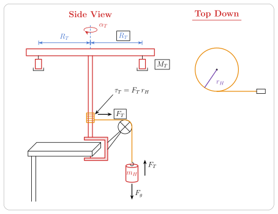

:::: {.content-visible when-meta="major"}
::: {.callout-important appearance="simple"}
**Major lab.** Every student turns in all three parts, and your grade depends on your partners' boards as much as your own. Check all three before any of them is photographed.
:::
::::
:::: {.content-visible unless-meta="major"}
::: {.callout-note appearance="simple"}
**Regular lab.** You turn in the part you worked on. In a group of two, each of you turns in your own part plus CON.
:::
::::

::: {.callout-caution appearance="simple"}
This page was written from the 2026 Lab 9 templates and the setup used in class this year. If the handout or your TA says something different, the handout and your TA win.
:::

## At a glance

Lab 9 runs over two class periods, with one report for each.

- **09A Setup (first class).** Two theory boards (the derivation on one, the setup diagram on the other), one QPD board, an annotated photo of the setup, and a screenshot of one trial in Graphical Analysis.
- **09B Performance (second class).** The Excel data table, a UDA board with the sample calculations and two physical values, two graphs, and the CON paragraph. The checklists are in [UDA in one look](#uda-quick) and [CON in one look](#con-quick).
- **Question.** How does the rotational inertia of the spinning T-bar depend on the mass added to it (even groups) or on how far that mass sits from the axle (odd groups)?
- **You measure.** For each of 15 trials, the string tension $F_T$ and the rotational acceleration $\alpha$, both read in Graphical Analysis. Also the hub radius $r_h$, the hanging mass $m_H$, the mass of one added piece $M_T$, and its distance $R_T$ from the axle.
- **You calculate.** The torque $\tau_T = r_h F_T$ for every trial, then one rotational inertia $I_{TOT}$ for each of the five settings, from a slope.
- **You graph.** Graph 1: torque against rotational acceleration, five data sets, one per setting. Graph 2: $I_{TOT}$ against $M_T$ (even groups) or against $R_T^2$ (odd groups).
- **You conclude.** One paragraph: the relationship, its equation with units, one constant from the slope with a percent difference, and the T-bar's own inertia from the intercept compared with Lab 8's.

## The setup

A vertical rod is clamped to the table. The T-bar crossbar sits on top of the rod, and one added piece of mass $M_T$ sits under each end, both at the same distance $R_T$ from the axle. At the bottom of the rod is a small hub with radius $r_h = 0.0210 \pm 0.0001\ \text{m}$. A string wraps around the hub, leaves it horizontally, runs over a pulley at the table edge, and drops to a hanging mass. Let go, the mass falls, the string unwinds, and the T-bar spins faster and faster.

Two sensors do the measuring.

- **The tension sensor** is a force sensor that falls with the hanging mass. It hangs **upside down**: its hook is tied to the string, and the slotted masses hang from its body. So it reads the whole pull of the string. Because it falls too, it is part of the hanging mass $m_H$.
- **The rotation sensor** is a second force sensor taped flat on top of the T-bar, with its power cord plugged in. It turns with the bar, and its gyroscope gives the angular velocity $\omega$ in Graphical Analysis. Because it turns with the bar, it is part of what you are measuring this week.

The two sensors are the same model, so Graphical Analysis has to be told which reading to take from each. Under **Sensor Channels**, pick **Force** for the hanging sensor and **Z-axis gyroscope** for the T-bar sensor.

## 09A Setup

### Theory board 1: the derivation

Everything you know about straight-line motion has a partner for spinning motion. Position $x$ becomes the angle $\theta$, velocity $v$ becomes the angular velocity $\omega$, and acceleration $a$ becomes the rotational acceleration $\alpha$. A force $F$ becomes a torque $\tau$, a twist. Mass $m$, how hard something is to speed up, becomes the rotational inertia $I$, how hard something is to spin up. And Newton's second law, $F = ma$, becomes $\tau = I\alpha$. That last line is the whole lab.

The whole derivation goes on this board. The tension sensor measures $F_T$ directly, so you do not need a free-body diagram of the hanging mass. ([Going deeper](#going-deeper) shows what that diagram would add.)

**The torque.** A torque is a force times its lever arm, the distance from the axle to the line the force acts along, measured at right angles. The string leaves the hub along a tangent, so that line is one hub radius from the axle, and the lever arm is $r_h$:

$$\tau_T = r_h F_T.$$

**Newton's second law for rotation**, with friction left out for now:

$$I_{TOT}\,\alpha = \tau_T.$$

Here $I_{TOT}$ is the rotational inertia of everything that spins: the T-bar, the rod, the hub, the rotation sensor and the two added pieces.

**What to graph.** Write every fit as $y = Ax + B$, with $A$ the slope and $B$ the intercept. The last equation says to put $y = \tau_T$ and $x = \alpha$. Then the slope is $A = I_{TOT}$, and with no friction the line goes through the origin. What if the axle has some friction? Friction works against the spin, so the string has to supply a little extra torque before the bar speeds up at all:

$$\tau_T = I_{TOT}\,\alpha + \tau_f.$$

The line moves up. The intercept $B = \tau_f$ is the friction torque, and it is **positive**. The slope is still $I_{TOT}$. This is why each setting uses three hanging masses and a slope, not one mass and a division: the slope sets the friction aside for you.

**What is inside $I_{TOT}$.** Rotational inertias add. A small mass $m$ at a distance $R$ from the axle adds $mR^2$, so the same mass counts four times as much at twice the distance. So the T-bar with the masses at the ends is much harder to spin up than with the same masses near the axle. Treat each added piece as a point. Two pieces, each of mass $M_T$, each at $R_T$:

$$I_{TOT} = I_0 + 2 M_T R_T^2.$$

Here $I_0$ is the rotational inertia of the T-bar with nothing added, $M_T$ is the mass of **one** piece, and the 2 counts the pieces.

**The straight line for your group.** Your group changes one thing and holds the other fixed.

- **Odd groups** change $R_T$ and hold $M_T$ at 100 g or 200 g. Graphed against $R_T$, the points curve upward, because $R_T$ is squared. To straighten the graph, plot against $R_T^2$ instead. The slope is $A = 2M_T$, so the experimental mass is $M_{T,\text{exp}} = A/2$. The intercept is $B = I_0$.
- **Even groups** change $M_T$ and hold $R_T$ fixed. The equation is already a straight line in $M_T$. Graph $I_{TOT}$ against $M_T$. The slope is $A = 2R_T^2$, so the experimental distance is $R_{T,\text{exp}} = \sqrt{A/2}$. The intercept is $B = I_0$.

Odd groups choose $R_T$ from 5, 10, 15, 20, 25 and 35 cm. Even groups choose $M_T$ from 50 to 300 g. Either way your group uses five settings. Convert centimeters to meters and grams to kilograms **before** you square anything.

**Units.** Torque is in m·N. The template writes it in that order so nobody mistakes it for joules, which are also a newton times a meter. Rotational acceleration is in rad/s², and a radian has no unit of its own. So the slope of graph 1 has units of m·N divided by 1/s², which works out to kg·m², the unit of a rotational inertia. The slope of graph 2 is in kg for odd groups and m² for even groups.

### Theory board 2: the diagram

The second board is the diagram only. Draw two views and label everything shown here.

{fig-alt="Side view: a red T-bar crossbar on a vertical rod that turns with rotational acceleration alpha T about a dashed vertical axis. Blue dimension lines mark R T from the axis to each end, and one mass M T hangs under each end. Near the bottom of the rod an orange string is wound on the hub. The rod is held by a red C-clamp on the edge of a table. The string runs horizontally from the hub to a pulley at the table edge and drops to the hanging mass m H. Arrows show the tension F T along the string at the hub, with tau T equals F T times r H, and F T up and F g down on the hanging mass. Top-down view: the hub as a circle of radius r H, with the string leaving it along a tangent toward the pulley."}

- **Side view.** The crossbar on the rod with the rotation $\alpha_T$ about the vertical axis, $R_T$ from the axis to each end, one $M_T$ hanging under each end, the hub with the string wound on it, the clamp on the table edge, the string over the pulley down to $m_H$, the pull $F_T$ along the string at the hub with $\tau_T = F_T r_H$, and $F_T$ up and $F_g$ down on the hanging mass.
- **Top-down view.** The hub of radius $r_H$ and the string leaving it along a tangent toward the pulley. The string pulls at right angles to the radius, which is why the lever arm is the radius and $\tau_T = F_T r_H$.

The diagram writes the hub radius as $r_H$ and the rotational acceleration as $\alpha_T$. The rest of this page writes them $r_h$ and $\alpha$. They are the same quantities.

### The QPD board

**The question.** The 09A report asks for one question. Pick the one for your group:

> Odd groups: What is the relationship between the total rotational inertia of the T-bar ($I_{TOT}$) and the distance of the added pieces from the axle ($R_T$)?

> Even groups: What is the relationship between the total rotational inertia of the T-bar ($I_{TOT}$) and the mass of each added piece ($M_T$)?

The torque against rotational acceleration graph is not a second question. It is the step that turns each setting into one value of $I_{TOT}$.

**The procedure, in two parts.** The report template asks for two parts and wants them kept apart. This is the usual way they split. Where the handout or your TA says otherwise, they win.

1. **Part 1: one value of $I_{TOT}$ for one setting of the T-bar.** For each of three hanging masses (290 g, 590 g and 790 g, tension sensor included), wind the string, start collecting, let go, and read the average $F_T$ and the slope $\alpha$ from the fall only. The slope of $\tau_T$ against $\alpha$ for those three trials is $I_{TOT}$.
2. **Part 2: repeat Part 1 for five settings** of your group's variable. Five settings of three trials each is 15 trials.

What the board should list:

::: {.sx-scroll}
| Symbol | Quantity | How it is measured | Unit |
|---|---|---|---|
| $r_h$ | radius of the hub the string wraps around | given, $0.0210 \pm 0.0001$ | m |
| $m_H$ | slotted masses **plus** the tension sensor | balance, weighed together as they hang | kg |
| $M_T$ | mass of **one** added piece | balance | kg |
| $R_T$ | centre of the axle to the centre of each piece | ruler | m |
| $F_T$ | string tension during the fall | tension sensor, average in Graphical Analysis | N |
| $\alpha$ | rotational acceleration during the fall | rotation sensor, slope of $\omega$ in Graphical Analysis | rad/s² |
:::

**Check the tension sensor before the first run.** Hold the T-bar still with the mass hanging. The sensor should read about $m_H g$, with the sensor counted in $m_H$. If it reads close to zero, it was zeroed with the mass hanging. Zero it upside down with nothing on the hook.

### The annotated setup photo

Six labels: $r_h$, $R_T$, $m_H$, $M_T$, the force sensor that reads the tension, and the rotational motion sensor (the one taped on the T-bar).

### The Graphical Analysis screenshot

The report wants one trial worked in the software.

1. Check the channels: **Force** on the hanging sensor, **Z-axis gyroscope** on the T-bar sensor.
2. Select only the fall: after you let go, and before the mass lands or the string runs out and starts to wind back up.
2. Use the **same** time window on both graphs.
3. Force graph: Statistics on the selection gives the average $F_T$. Leave out the spike when the string goes tight.
4. Angular velocity graph: a linear fit over the same window. Its slope is $\alpha$.
5. Check that the angle is in radians, not degrees or rotations.
6. The sign of $\alpha$ depends on which way the bar spins. Use its size, and take $F_T$ as positive too, so $\tau_T$ and $\alpha$ always have the same sign.

## 09B Performance

The 09B report has a UDA part and a CON part, and on this major lab everyone turns in both. This section starts with the two boards in one look, the same lists as the reminder boards in the room, so you can check yours before the photo. The details come after.

::: {.sx-scroll}
| Report section | What goes in it |
|---|---|
| UDA | A screenshot of the Excel data table, with the mean, δa and δr rows at the bottom filled in |
| UDA | A photo of the UDA board: the sample calculations and the two physical values |
| UDA | Graph 1: torque against rotational acceleration, five data sets, each with its trendline equation |
| UDA | Graph 2: $I_{TOT}$ against your group's variable, with its trendline equation |
| CON | A photo of the CON board: one paragraph |
:::

::: {.callout-important appearance="simple"}
**Units on everything.** The reminder boards in the room say UNITS on nearly every line. A number with no unit is the easiest way to lose points this week. [Units, line by line](#units-09b) gives the unit of every quantity in the report.
:::

### UDA in one look {#uda-quick}

```{=html}
<div class="sx-board" role="img" aria-label="Example UDA whiteboard for Lab 9: header, a left half with the sample calculations and a right half with the equation of graph 2 and the two physical values">
  <div class="sx-board__header"><span>UDA</span><span>Your name · partners' names</span></div>
  <div class="sx-board__columns">
    <div class="sx-board__col">
      <span class="sx-board__label">Sample calculations</span>
      <p>$\tau_T = r_h F_T = (0.021\,\text{m})(2.822\,\text{N}) = 0.0593\,\text{m·N}$</p>
      <p>$R_T^2 = (0.15\,\text{m})^2 = 0.0225\,\text{m}^2$</p>
      <p class="sx-board__faint">the $R_T^2$ line is for odd groups only</p>
    </div>
    <div class="sx-board__col">
      <span class="sx-board__label">Physical values (2)</span>
      <p>$I_{TOT} = (0.0112\,\text{kg·m}^2) + (0.206\,\text{kg})\,R_T^2$</p>
      <p>$M_{T,\text{exp}} = \dfrac{A}{2} = \dfrac{0.206\,\text{kg}}{2} = 0.103\,\text{kg}$</p>
      <p>$I_0 = B = 0.0112\,\text{kg·m}^2$</p>
    </div>
  </div>
</div>
<p class="sx-board__caption">An odd group's UDA board, with invented numbers. Even groups skip the $R_T^2$ line and find $R_{T,\text{exp}} = \sqrt{A/2}$ in place of $M_{T,\text{exp}}$.</p>
```

::: {.sx-checklist}
- [ ] **Sample calculations, with units.** One worked torque, $\tau_T = r_h F_T$, from a real row. Odd groups add one $R_T^2$.
- [ ] **Two physical values, with units.** The trendline of graph 2 in physical symbols, then the constant from its slope ($M_{T,\text{exp}}$ or $R_{T,\text{exp}}$) and the T-bar's own inertia $I_0$ from its intercept.
- [ ] **Uncertainties, in Excel.** The mean, δa and δr rows filled in for every column. Each δa has its column's unit, and each δr has none. $I_{TOT}$ gets $\delta_a = 0.0005\ \text{kg·m}^2$.
- [ ] **Graphs, in Excel.** A title, both axes labelled with units, and a trendline equation on every data set.
:::

### CON in one look {#con-quick}

```{=html}
<div class="sx-board" role="img" aria-label="Layout of the CON whiteboard for Lab 9: one paragraph of four sentences, labelled a to d">
  <div class="sx-board__header"><span>CON</span><span>Your name · partners' names</span></div>
  <div class="sx-board__zone sx-board__zone--grow">
    <p><strong>a</strong> The relationship between $I_{TOT}$ and $R_T^2$ (or $M_T$) is linear.
    <strong>b</strong> $I_{TOT} = (\text{intercept in kg·m}^2) + (\text{slope with its unit})\,R_T^2$.
    <strong>c</strong> The slope gives $M_{T,\text{exp}}$ (or $R_{T,\text{exp}}$) with units, compared with the actual value with units, as a percent difference.
    <strong>d</strong> The intercept gives $I_0$ with units, compared with Lab 8's $0.0101\,\text{kg·m}^2$, as a percent difference.</p>
    <div class="sx-board__note">one paragraph, one sentence per item, in order</div>
  </div>
</div>
<p class="sx-board__caption">The CON board. The letters show the order. They do not go on the board.</p>
```

::: {.sx-checklist}
- [ ] **(a) The relationship, stated outright.** It is linear, between $I_{TOT}$ and $R_T^2$ (odd groups) or $M_T$ (even groups).
- [ ] **(b) The equation in physical symbols, not $x$ and $y$.** A unit on the intercept and a unit on the slope.
- [ ] **(c) The physical value from the slope**, with units, compared with the actual value from the balance or the ruler, with units, and the percent difference.
- [ ] **(d) The physical value from the intercept**, $I_0$ with units, compared with Lab 8's $I_0 = 0.0101\ \text{kg·m}^2$, and the percent difference.
:::

### Units, line by line {#units-09b}

::: {.sx-scroll}
| Quantity | Unit | Where you write it |
|---|---|---|
| $\tau_T$ | m·N | column E, sample calculation, graph 1 |
| $\alpha$ | rad/s² | column D, graph 1 |
| $R_T^2$ (odd groups) | m² | column G, sample calculation, graph 2 |
| $I_{TOT}$, and each slope of graph 1 | kg·m² | column H, graph 1, graph 2 |
| slope $A$ of graph 2, odd groups | kg | UDA board, CON (b) |
| slope $A$ of graph 2, even groups | m² | UDA board, CON (b) |
| intercept $B$ of graph 2, $I_0$ | kg·m² | UDA board, CON (b) and (d) |
| $M_{T,\text{exp}}$ (odd groups) | kg | UDA board, CON (c) |
| $R_{T,\text{exp}}$ (even groups) | m | UDA board, CON (c) |
| $\delta_a$ of a column | its column's | Excel |
| $\delta_r$ of a column | none, use % | Excel |
| percent difference | none, use % | CON (c) and (d) |
:::

**Where the slope's unit comes from.** On a straight-line graph, the $y$ value is the slope times the $x$ value, plus the intercept. So the units have to match:

$$(\text{unit of } y) = (\text{unit of the slope}) \times (\text{unit of } x).$$

On graph 2, $y = I_{TOT}$, in kg·m². If $x$ is $M_T$, in kg, the slope has to supply the m². If $x$ is $R_T^2$, in m², the slope has to supply the kg. So the unit of the slope already tells you what it measures: a slope in kg is a mass, $2M_T$, and a slope in m² is a distance squared, $2R_T^2$. The intercept is a value of $y$, so it is in kg·m² for every group. Graph 1 works the same way: m·N divided by rad/s² is kg·m², a rotational inertia.

**The two question marks.** Two lines on the reminder boards say UNITS? with a question mark, because those are the places where the right answer can be no unit at all. The relationship in words, item (a), has no numbers, so it has no units. A δr and a percent difference are one number divided by another in the same unit, so the unit cancels. For those, the % sign is all you write.

### The UDA board in detail

**Sample calculations.** Pick a real row of your sheet and write the numbers that feed it, each with its unit. Every torque row uses the same formula, so one worked torque shows how all 15 were made. Invented numbers, for an odd group with $M_T = 0.100\ \text{kg}$, the 0.29 kg hanging mass and $R_T = 15\ \text{cm}$:

$$\tau_T = r_h F_T = (0.021\ \text{m})(2.822\ \text{N}) = 0.0593\ \text{m·N}, \qquad R_T^2 = (0.15\ \text{m})^2 = 0.0225\ \text{m}^2.$$

Even groups have no $R_T^2$ line. Their torque line looks the same.

**The two physical values.** The trendline of graph 2 gives a slope $A$ and an intercept $B$. Write the trendline on the board first, in physical symbols with a unit on each number, the way the whiteboard in class shows it:

$$I_{TOT} = (B \text{ with units}) + (A \text{ with units})\,R_T^2 \qquad\text{or}\qquad I_{TOT} = (B \text{ with units}) + (A \text{ with units})\,M_T.$$

Then the two values. For the odd group above, with $A = 0.206\ \text{kg}$ and $B = 0.0112\ \text{kg·m}^2$:

$$I_{TOT} = (0.0112\ \text{kg·m}^2) + (0.206\ \text{kg})\,R_T^2,$$

$$M_{T,\text{exp}} = \frac{A}{2} = \frac{0.206\ \text{kg}}{2} = 0.103\ \text{kg}, \qquad I_0 = B = 0.0112\ \text{kg·m}^2.$$

For an even group with $R_T = 0.250\ \text{m}$, $A = 0.127\ \text{m}^2$ and $B = 0.0109\ \text{kg·m}^2$:

$$I_{TOT} = (0.0109\ \text{kg·m}^2) + (0.127\ \text{m}^2)\,M_T,$$

$$R_{T,\text{exp}} = \sqrt{\frac{A}{2}} = \sqrt{\frac{0.127\ \text{m}^2}{2}} = 0.252\ \text{m}, \qquad I_0 = B = 0.0109\ \text{kg·m}^2.$$

Carry the units through and they check the work for you. Half of a slope in kg is in kg, a mass. The square root of half a slope in m² is in m, a distance. If what comes out is not a mass or a distance, the slope went in with the wrong unit.

**Uncertainties.** These live in Excel, in the three rows at the bottom of the template: **mean**, **δa** and **δr** (rows 23 to 25). Every column gets all three. The rules are the ones from every lab, and the [uncertainty guide](../01-uncertainty.qmd) walks through them one column at a time. For the two calculated columns, find δr first, then δa.

::: {.sx-scroll}
| Column | $\delta_a$, in the column's unit | $\delta_r$, no unit |
|---|---|---|
| B, $m_H$ | from the balance, in kg | $\delta_a$ / mean |
| C, $F_T$ | the standard deviation from Statistics over the fall, in N | $\delta_a$ / mean |
| D, $\alpha$ | 0.01 rad/s², already in the template | $\delta_a$ / mean |
| E, $\tau_T$ | $\delta_r$ × mean, in m·N | the larger $\delta_r$ of $F_T$ and $r_h$ |
| F, $M_T$ or $R_T$ | 0.001 kg or 0.001 m, already in the template | $\delta_a$ / mean |
| G, $R_T^2$ (odd groups) | $\delta_r$ × mean, in m² | the $\delta_r$ of $R_T$ |
| H, $I_{TOT}$ | 0.0005 kg·m², given in class | $\delta_a$ / mean |
:::

The torque is a product, so it takes the larger $\delta_r$ of its two inputs. For $r_h$ that is $0.0001\ \text{m} / 0.021\ \text{m} = 0.5\%$. A square is a product too, so $R_T^2$ takes the $\delta_r$ of $R_T$. The values of $I_{TOT}$ are slopes, which the template's rules do not reach, so use the δa given in class.

Thinking about units helps here as well. A δa is the give-or-take on a column's values, so it has that column's unit. A δr is δa divided by the mean, two numbers in the same unit, so it has none. For the odd group above, $R_T$ has a mean of 0.15 m, so its δr is $0.001\ \text{m} / 0.15\ \text{m} = 0.007$, about 0.7%, with no unit. $R_T^2$ takes the same 0.7%, and its mean of $0.0275\ \text{m}^2$ gives $\delta_a = 0.007 \times 0.0275\ \text{m}^2 = 0.0002\ \text{m}^2$. A δa that comes out in some other unit, or a δr that comes out with a unit, means a cell reference is off.

**The two graphs.** Each needs a title, both axes labelled with the quantity and its unit, and a linear trendline with its equation on the chart.

1. **Graph 1, torque against rotational acceleration.** A title such as "Torque vs. Rotational Acceleration". $\tau_T$ in m·N up the side, $\alpha$ in rad/s² along the bottom. Five data sets, one per setting, each with its own trendline and equation, and a legend that says which setting is which. Each slope is the $I_{TOT}$ for one setting, in kg·m². Each intercept is a small positive friction torque, in m·N.
2. **Graph 2, $I_{TOT}$ against your group's variable.** A title such as "Total Rotational Inertia vs. $R_T^2$". $I_{TOT}$ in kg·m² up the side. Along the bottom, $R_T^2$ in m² for odd groups (slope in kg) or $M_T$ in kg for even groups (slope in m²). One trendline with its equation. The intercept is $I_0$, in kg·m².

### In Excel

The template has the hub radius already typed in as a constant, $r_h = 0.021\ \text{m}$, with a note that you may change the constants. Record the two constants your group does not change ($R_T$ for even groups, $M_T$ for odd groups) next to it. The 15 trials sit in five blocks of three rows, one block per setting. The template's example hanging masses are 0.19, 0.29 and 0.59 kg. Type your own: the board in class lists 290 g, 590 g and 790 g, which already count the tension sensor, and they go in as 0.29, 0.59 and 0.79 kg.

::: {.sx-scroll}
| Column | What goes in it | Unit | Sample calculation on the board |
|---|---|---|---|
| B, $m_H$ | hanging mass, sensor included | kg | no |
| C, $F_T$ | average tension from Graphical Analysis | N | no |
| D, "a" | the rotational acceleration $\alpha$, not the linear acceleration of the mass | rad/s² | no |
| E, $\tau_T$ | $F_T \times r_h$ | m·N | yes, one worked example |
| F | your group's variable, $M_T$ or $R_T$ | kg or m | no |
| G (odd groups) | $R_T^2$ | m² | yes |
| H, $I_{TOT}$ | slope of $\tau_T$ against $\alpha$ for each block of three | kg·m² | no, it is a slope |
:::

Some things about this sheet that are not obvious from looking at it:

- **Only the first torque cell has a formula.** E8 holds `=C8*$G$3`. Fill it down through all 15 rows.
- **Column G is blank.** It is an empty merged block with no header. Odd groups type a header and a formula for $R_T^2$, such as `=F8^2`, and fill it down.
- **The order inside `SLOPE`.** Excel's `SLOPE` takes the $y$ column first: `=SLOPE(torque cells, alpha cells)`, as H8 already does. Swapped, it gives $1/I$.
- **The chart is already there.** The template's chart plots the five blocks as five data sets of torque against rotational acceleration. Add a linear trendline with its equation to each.

### Check your torques

While the mass falls, the tension is a little less than $m_H g$, so every torque must come out a little **under** $m_H g\,r_h$. [Going deeper](#going-deeper) shows why. With $g = 9.81\ \text{m/s}^2$ and $r_h = 0.021\ \text{m}$:

::: {.sx-scroll}
| $m_H$ (kg) | $m_H g$ (N) | $m_H g\,r_h$ (m·N) | largest shortfall | bare T-bar $\alpha$ (rad/s²) |
|---|---|---|---|---|
| 0.29 | 2.845 | 0.0597 | 1.3% | 5.8 |
| 0.59 | 5.788 | 0.1215 | 2.5% | 11.7 |
| 0.79 | 7.750 | 0.1627 | 3.3% | 15.6 |
:::

The last two columns use Lab 8's $I_0 = 0.0101\ \text{kg·m}^2$. With nothing added to the bar, the rotational acceleration should come out near the last column. Added pieces make $I_{TOT}$ larger, so $\alpha$ gets smaller and the torque sits even closer to $m_H g\,r_h$. A torque well under these numbers points to a sensor zeroed with the mass hanging, or to $r_h$ in the wrong unit. A torque about twice as large means $r_h$ went in as a diameter.

### The CON paragraph in detail {#con-detail}

One paragraph, with the four items from the 09B report in order, one sentence each. Write the equation with the physical symbols, not $x$ and $y$.

1. **(a) The relationship between your graphed quantities, in words.** Name both quantities and say the relationship is linear. This sentence has no numbers, so it needs no units.
2. **(b) The equation, with the real symbols.** $I_{TOT}$, then the intercept with kg·m², then the slope with its own unit times $R_T^2$ or $M_T$.
3. **(c) One constant from the slope, compared with its actual value.** Odd groups: $M_{T,\text{exp}} = A/2$ against the balance. Even groups: $R_{T,\text{exp}} = \sqrt{A/2}$ against the ruler. Units on both values, then the percent difference.
4. **(d) Your T-bar-only inertia, compared with Lab 8's.** $I_0$ from the intercept against Lab 8's $I_0 = 0.0101\ \text{kg·m}^2$, the class value on the board. Units on both values, then the percent difference. If your TA says to use your own group's Lab 8 value, use that one.

Both comparisons use the percent difference from the actual value:

$$\%\,\text{diff} = \frac{\text{yours} - \text{actual}}{\text{actual}} \times 100\%.$$

The units cancel, so the % sign is all that goes after the number. If your TA gives a different formula, use theirs.

Put together, with the invented numbers from the UDA examples:

> **Odd group, $M_T = 0.100\ \text{kg}$.** The relationship between the total rotational inertia of the T-bar and the square of the distance of the added pieces from the axle is linear. The trendline was $I_{TOT} = (0.0112\ \text{kg·m}^2) + (0.206\ \text{kg})\,R_T^2$. Half the slope gives a mass of $M_{T,\text{exp}} = 0.103\ \text{kg}$ for each piece, against the actual $0.100\ \text{kg}$ from the balance, a percent difference of $3.0\%$. The intercept gives $I_0 = 0.0112\ \text{kg·m}^2$ for the T-bar alone, against $0.0101\ \text{kg·m}^2$ from Lab 8, a percent difference of $10.9\%$, higher because the rotation sensor spun with the T-bar this week.

> **Even group, $R_T = 0.250\ \text{m}$.** The relationship between the total rotational inertia of the T-bar and the mass of each added piece is linear. The trendline was $I_{TOT} = (0.0109\ \text{kg·m}^2) + (0.127\ \text{m}^2)\,M_T$. The square root of half the slope gives a distance of $R_{T,\text{exp}} = 0.252\ \text{m}$ from the axle to each piece, against the actual $0.250\ \text{m}$ from the ruler, a percent difference of $0.8\%$. The intercept gives $I_0 = 0.0109\ \text{kg·m}^2$ for the T-bar alone, against $0.0101\ \text{kg·m}^2$ from Lab 8, a percent difference of $7.9\%$, higher because the rotation sensor spun with the T-bar this week.

Expect your intercept to come out **above** Lab 8's, because the rotation sensor was not on the T-bar in Lab 8. Name the sensor as the reason.

## Common slips

- A number on the UDA or CON board with no unit. The slope of graph 2 is the one most often left bare: it is in kg or m², never kg·m².
- A δa without a unit, or a δr with one.
- The trendline written as $y = Ax + B$ on the CON board in place of $I_{TOT}$ and $R_T^2$ or $M_T$.
- $m_H$ without the tension sensor. The sensor falls with the mass, so it belongs in $m_H$.
- A tension sensor zeroed with the mass hanging. It then reads close to zero with the bar held still.
- $M_T$ as the total of both pieces. $M_T$ is **one** piece, and the 2 in $2M_T R_T^2$ counts the pieces. Typing in the total and then halving the slope lands 50% off.
- Squaring before converting. 15 cm squared is 225 cm², which is 0.0225 m², not 225.
- $R_T$ measured to the edge of a piece instead of its centre.
- $r_h$ as a diameter, or in centimeters.
- $\alpha$ in degrees or rotations instead of radians.
- Different time windows on the force graph and the angular velocity graph, or a window that includes the release, the landing or the string winding back up.
- `SLOPE` with the columns swapped, which gives $1/I$.
- A negative friction intercept on the board. Friction opposes the spin, so the string has to supply extra torque, and $\tau_f$ is added.
- A hanging mass too small lets friction take a large share of the torque, and the points scatter. A hanging mass too large makes the fall so short there is little to fit.
- The rotation sensor's power cord dragging or winding up during a run. That adds friction and scatter.

## Going deeper

**Why a figure skater spins faster with her arms in.** A skater pulling her arms in moves mass closer to the axle. Since every bit of mass counts as $mR^2$, pulling it in shrinks her rotational inertia a lot, and she spins faster to make up for it. The T-bar is the same idea run the other way: move the pieces out from 10 cm to 20 cm and they count four times as much.

**Why the tension is a little less than the weight.** This is not on your boards, because the sensor measures $F_T$ directly, but it explains the check table. Two forces act on the hanging mass: its weight $m_H g$ pulling down and the tension $F_T$ pulling up. Take down as positive. The string does not slip on the hub, so the mass falls exactly as fast as the edge of the hub moves:

$$m_H g - F_T = m_H a, \qquad a = r_h\alpha.$$

Solve for the tension:

$$F_T = m_H\,(g - r_h\alpha).$$

While the mass falls, the tension is a little **less** than its weight. If the string pulled with the full weight, the mass would not speed up at all. That is why the lab measures $F_T$ with a sensor instead of using $m_H g$. Put this tension into $r_h F_T = I_{TOT}\alpha$ and collect the $\alpha$ terms to get the rotational acceleration you should expect:

$$\alpha = \frac{m_H g\, r_h}{I_{TOT} + m_H r_h^2}.$$

With $I_{TOT} = 0.0101\ \text{kg·m}^2$, Lab 8's bare T-bar, this gives the last column of the check table. The shortfall in the tension is $m_H r_h\alpha$, the fraction $r_h\alpha/g$ of the weight. For the lightest hanging mass on the bare bar, $\alpha = 5.84\ \text{rad/s}^2$, so $r_h\alpha = (0.021\ \text{m})(5.84\ \text{rad/s}^2) = 0.123\ \text{m/s}^2$, about 1.3% of $g$.

**Why the intercept of graph 2 comes out high.** Two things push it up. The rotation sensor spins with the bar this week, and it adds about $m_s d^2$, its mass times the square of its distance from the axle, plus its own small inertia. And the added pieces are not points. By the parallel-axis theorem, each piece also carries its own inertia about its centre, $I_{cm}$, so two pieces add $2I_{cm}$. For odd groups that extra does not change as $R_T$ changes, so it lands in the intercept. For even groups adding more of the same piece, it grows with the mass and nudges the slope up a little.

**Which settings give the cleanest line.** The 5 cm setting with 100 g pieces adds only $2(0.100)(0.05)^2 = 0.0005\ \text{kg·m}^2$, the same size as the uncertainty on each $I_{TOT}$, so that point mostly measures $I_0$. For even groups, a large $R_T$ gives a much larger change: from 50 g to 300 g at 25 cm, $I_{TOT}$ grows by $2(0.250)(0.25)^2 = 0.031\ \text{kg·m}^2$. The slowest case is 300 g pieces at 35 cm with the 0.29 kg hanging mass, where $\alpha$ is only about 0.7 rad/s². Friction matters most there, and the fall has to last long enough to fit.
